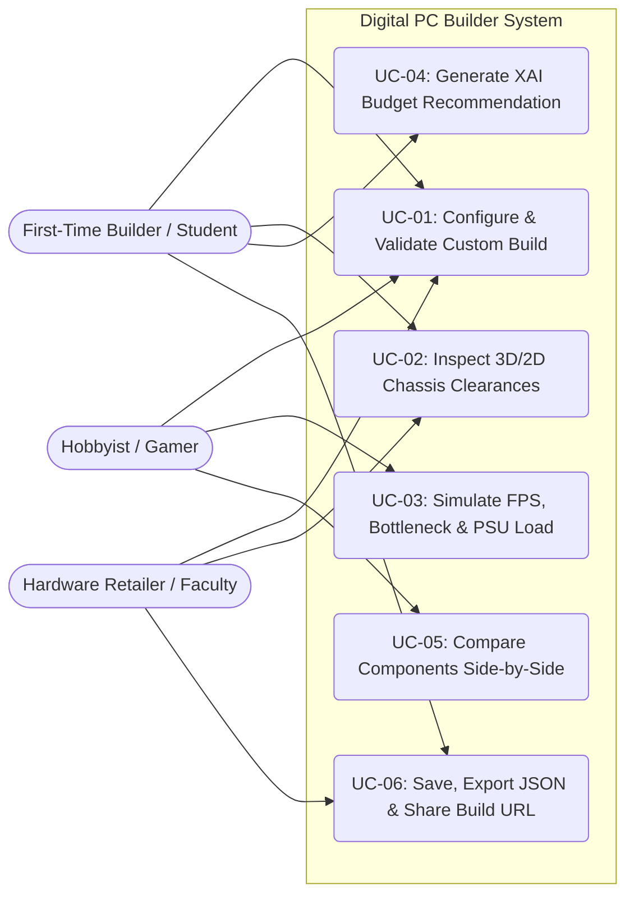

# 02 — Software Requirements Specification (SRS)

**Project:** Digital PC Builder: Virtual Compatibility & Simulation System  
**Standard Reference:** IEEE 830 / ISO/IEC/IEEE 29148 Software Requirements Specification Structure

---

## 1. Functional Requirements (FR)

| Req ID | Module | Requirement Description | Priority |
| :--- | :--- | :--- | :---: |
| **FR-01** | **Interactive Builder** | The system shall allow users to browse, search, filter by brand/compatibility, sort by price/performance/name, and select components across 8 categories (`CPU`, `Motherboard`, `RAM`, `GPU`, `Storage`, `PSU`, `Case`, `Cooler`). | Must Have |
| **FR-02** | **Candidate Pre-Check** | The system shall evaluate every unselected part in the active catalog against the current build state and visibly badge incompatible parts with the specific reason(s) before selection. | Must Have |
| **FR-03** | **Multi-Drive Storage** | The system shall support installing up to 4 concurrent storage drives (mixing `M.2 2280 NVMe`, `2.5-inch SATA SSD`, and `3.5-inch HDD`) and validate them against motherboard M.2/SATA ports and case drive bays. | Must Have |
| **FR-04** | **Compatibility Engine** | The system shall deterministically validate at minimum: CPU/MB socket, VRM thermal tier, DDR4/DDR5 RAM generation, DIMM slot count & max capacity, CPU memory controller support, MB form factor vs. case, GPU length vs. case, air cooler height vs. case, AIO radiator size vs. case, cooler socket & TDP rating vs. CPU TDP, RAM height vs. cooler overhang clearance, PSU form factor vs. case, PSU wattage vs. peak transient load, GPU 8-pin/16-pin PCIe power connectors, and display output availability (discrete GPU or onboard iGPU). | Must Have |
| **FR-05** | **3D & 2D Case View** | The system shall render selected components inside an interactive 3D WebGL chassis (`@react-three/fiber`) with an instant toggle and automatic error-boundary fallback to a 2D SVG technical blueprint. | Must Have |
| **FR-06** | **Performance & Bottleneck Sim** | The system shall simulate 1080p, 1440p, and 4K gaming FPS across 4 game genres, compute Workstation/Gaming indices (0–100), calculate directional CPU/GPU bottleneck percentages, and plot an 80+ PSU efficiency curve. | Must Have |
| **FR-07** | **Explainable AI (XAI) Recommender** | The system shall generate a 100% compatible build given a target budget (`PHP`), workload profile (`Gaming`, `Workstation`, `Academic`, `Streaming`), and form factor constraint, displaying the exact factor weights, raw scores, and point contributions for every recommended part. | Must Have |
| **FR-08** | **Component Comparator** | The system shall allow side-by-side comparison of up to 4 components within any category, deriving price-to-performance metrics and technical attributes directly from the dataset. | Must Have |
| **FR-09** | **Persistence & Sharing** | The system shall support saving builds to browser `localStorage`, exporting/importing builds as `.json` files, and encoding builds into shareable URL query strings (`?build=...`). | Must Have |
| **FR-10** | **Beginner Learn Mode & Presets** | The system shall include interactive hardware glossary tooltips (`socket`, `tdp`, `ramClearance`, `psuHeadroom`, `pcie16Pin`, `bottleneck`, `formFactor`) and 5 curated preset builds (including budget, balanced valid, and intentional compatibility-error builds). | Must Have |

---

## 2. Non-Functional Requirements (NFR)

| Req ID | Category | Specification |
| :--- | :--- | :--- |
| **NFR-01** | **Performance & Responsiveness** | Compatibility evaluation, candidate filtering, and XAI build generation shall execute in `< 50 ms` on standard client hardware with zero network latency. |
| **NFR-02** | **Reliability & Fallback** | If WebGL context creation fails on a laboratory computer, the `ThreeErrorBoundary` shall seamlessly fall back to the 2D SVG Blueprint view without application crash. |
| **NFR-03** | **Usability & Accessibility** | The UI shall support keyboard navigation, clear semantic status colors accompanied by icons/text (`Pass`, `Warn`, `Fail`), responsive layouts (mobile, tablet, desktop), and Dark/Light theme switching. |
| **NFR-04** | **Maintainability & Type Safety** | All domain engines and dataset files shall compile with zero errors under `TypeScript` strict mode (`tsc --noEmit`), and core engines shall be covered by automated `Vitest` unit tests. |
| **NFR-05** | **Portability & Zero-Backend** | The application shall run completely client-side via `npm install && npm run dev` without requiring external API keys, paid services, or database servers. |

---

## 3. User Stories

1. **As a First-Time PC Builder**, I want the part picker to warn me *before* I click a CPU cooler or RAM kit that will physically collide, so that I do not buy parts that cannot fit together during assembly.
2. **As a Budget-Conscious MMSU Student**, I want to enter my `₱25,000` budget and select `Academic, Programming & Office` in the XAI Recommender, so that I can get a complete APU build with a transparent explanation of why each part was chosen.
3. **As a Competitive Gamer**, I want to simulate 1080p and 1440p FPS and check whether my CPU is bottlenecking my GPU before upgrading, so that I spend my budget on the component that actually increases frame rates.
4. **As a Local Hardware Retailer**, I want to configure a verified build with a customer and export a `.JSON` manifest or copy a shareable URL link, so that our assembly technicians have an exact, conflict-free Bill of Materials.
5. **As an IT / Computer Architecture Instructor**, I want to load an intentional "Hidden Compatibility Traps" preset build during class, so that students can visually inspect and fix real-world dimensional and electrical errors.

---

## 4. Use Case Specifications

### Use Case Diagram

### Detailed Use Case: UC-01 Configure & Validate Custom Build
- **Primary Actor:** First-Time Builder / Student
- **Preconditions:** Application is loaded in the browser (`Builder` or `Home` tab).
- **Main Success Scenario:**
  1. Actor selects a hardware slot (e.g., `Motherboard`) or loads a starter preset.
  2. System runs `checkCandidatePartCompatibility()` across all 14 catalog items in that category and badges any incompatible items.
  3. Actor selects a component; System updates `useBuildStore` and invokes `evaluateCompatibility(currentBuild)`.
  4. System updates total cost (`PHP`), typical/peak wattage, 3D/2D slot placement, and the `CompatibilityPanel` diagnostics list.
- **Alternate / Exception Flows:**
  - *4a. Physical or Electrical Conflict Detected:* System highlights the affected slots in crimson red (`#f43f5e`), increments the conflict badge in the top navbar, and displays an actionable **Fix Recommendation** with one-click slot jump buttons.

---

## 5. System & Design Constraints
- **Technical Accuracy Constraint:** All hardware claims (such as dual-channel `2-Channel DDR5` support on mainstream AM5 and LGA1700 processors) must be derived strictly from dataset attributes (`cpu.memoryChannels`, `cpu.supportedMemoryTypes`) rather than hardcoded strings.
- **Offline Execution Constraint:** No external network requests are required at runtime; all 112 parts, presets, and engines are bundled locally.
