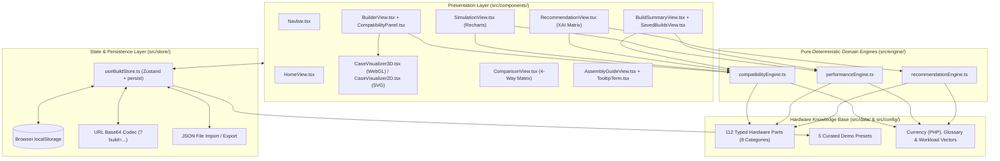

# 03 — System Design Document (SDD)

**Project:** Digital PC Builder: Virtual Compatibility & Simulation System  
**Institution:** MMSU College of Computing and Information Sciences (CCIS)

---

## 1. Architectural Overview
The application implements a **Layered Client-Side Domain-Driven Architecture** in React + TypeScript, strictly separating pure domain logic (`src/engine/`) from reactive state (`src/store/`) and presentation components (`src/components/`).

---

## 2. Module Breakdown

| Module Path | Responsibility |
| :--- | :--- |
| `src/types/pc.ts` | Defines strict TypeScript interfaces for `BaseComponent`, all 8 part subtypes (`CPU`, `Motherboard`, `RAM`, `GPU`, `Storage`, `PSU`, `PCCase`, `CPUCooler`), `CompatibilityReport`, and `XAIRecommendationResult`. |
| `src/config/constants.ts` | Centralizes `CURRENCY_CONFIG` (`PHP` / `₱`), `CATEGORY_METADATA`, `HARDWARE_GLOSSARY` terms, and `USE_CASE_PROFILES` budget split vectors. |
| `src/data/*.ts` | Contains 14 realistic components per category (`cpus.ts`, `motherboards.ts`, `ram.ts`, `gpus.ts`, `storage.ts`, `psus.ts`, `cases.ts`, `coolers.ts`) and 5 curated presets (`presets.ts`). |
| `src/engine/compatibilityEngine.ts` | Pure rule evaluation engine (`evaluateCompatibility`, `checkCandidatePartCompatibility`, `calculateSystemPower`). |
| `src/engine/performanceEngine.ts` | Simulates 1080p/1440p/4K FPS, directional CPU/GPU bottleneck percentages, thermal/acoustic output, and 80+ PSU efficiency curves. |
| `src/engine/recommendationEngine.ts` | Explainable AI (XAI) Multi-Criteria Decision Analysis (MCDA) engine generating compatible builds with per-part factor weights and scores. |
| `src/store/useBuildStore.ts` | Manages active build state, active tab, 3D/2D visualizer mode, Dark/Light theme, Learn Mode tooltips, `localStorage` saved builds, JSON export/import, and URL base64 sharing. |

---

## 3. Data Model / Entity-Relationship Diagram (ERD)

```mermaid
erDiagram
  PC_BUILD_STATE ||--o| CPU : "installs 1"
  PC_BUILD_STATE ||--o| MOTHERBOARD : "installs 1"
  PC_BUILD_STATE ||--o| RAM : "installs 1 kit"
  PC_BUILD_STATE ||--o| GPU : "installs 0..1"
  PC_BUILD_STATE ||--o{ STORAGE : "installs 1..4"
  PC_BUILD_STATE ||--o| PSU : "installs 1"
  PC_BUILD_STATE ||--o| PC_CASE : "installs 1"
  PC_BUILD_STATE ||--o| CPU_COOLER : "installs 1"

  CPU {
    string id PK
    string brand
    string name
    number price
    string socket "AM4 | AM5 | LGA1700"
    number cores
    number threads
    number baseClockGHz
    number boostClockGHz
    number tdpWatts
    boolean integratedGraphics
    string_array supportedMemoryTypes "DDR4 | DDR5"
    number memoryChannels "2 (Dual-Channel)"
    number benchmarkScore
    number gamingScore
    number productivityScore
  }

  MOTHERBOARD {
    string id PK
    string socket "AM4 | AM5 | LGA1700"
    string chipset
    string formFactor "ATX | Micro-ATX | Mini-ITX"
    string ramType "DDR4 | DDR5"
    number ramSlots
    number maxRamGB
    string pcieVersion
    number m2Slots
    number sataPorts
    string vrmTier
  }

  RAM {
    string id PK
    string type "DDR4 | DDR5"
    number capacityGB
    number speedMHz
    number modules
    number casLatency
    number heightMm
  }

  GPU {
    string id PK
    string chipset
    number vramGB
    number lengthMm
    number tdpWatts
    number recommendedPsuWatts
    number eightPinConnectors
    number sixteenPinConnectors
    number slotWidth
    number benchmarkScore
  }

  STORAGE {
    string id PK
    string type "NVMe | SATA SSD | HDD"
    number capacityGB
    string interface
    string formFactor "M.2 2280 | 2.5-inch | 3.5-inch"
    number readSpeedMBps
  }

  PSU {
    string id PK
    number wattage
    string efficiencyRating
    string formFactor "ATX | SFX"
    string modular
    number pcie8Pin
    number pcie16Pin
  }

  PC_CASE {
    string id PK
    string formFactor
    string_array supportedMotherboards
    number maxGpuLengthMm
    number maxCoolerHeightMm
    number maxRadiatorMm
    string_array supportedPsuFormFactors
    number driveBays25
    number driveBays35
  }

  CPU_COOLER {
    string id PK
    string type "Air | AIO"
    string_array supportedSockets
    number heightMm
    number radiatorSizeMm
    number tdpRatingWatts
    number ramClearanceMm
  }
```

---

## 4. Compatibility Rule Matrix

| Rule ID | Rule Category | Components Involved | Validation Condition (Pass / Warn / Fail) |
| :--- | :--- | :--- | :--- |
| `rule-cpu-mb-socket` | Socket & Platform | `CPU`, `Motherboard` | **Pass:** `cpu.socket === mb.socket` **Fail:** `cpu.socket !== mb.socket` |
| `rule-mb-vrm-thermal` | Socket & Platform | `CPU`, `Motherboard` | **Warn:** `cpu.tdpWatts >= 170 && mb.vrmTier === 'Entry'` |
| `rule-display-output` | System Completeness | `CPU`, `GPU` | **Pass:** `gpu !== null \|\| cpu.integratedGraphics === true` **Fail:** `gpu === null && !cpu.integratedGraphics` |
| `rule-ram-type-mb` | Memory (RAM) | `RAM`, `Motherboard` | **Pass:** `ram.type === mb.ramType` **Fail:** `ram.type !== mb.ramType` |
| `rule-ram-slots` | Memory (RAM) | `RAM`, `Motherboard` | **Pass:** `ram.modules <= mb.ramSlots` **Fail:** `ram.modules > mb.ramSlots` |
| `rule-ram-capacity` | Memory (RAM) | `RAM`, `Motherboard` | **Pass:** `ram.capacityGB <= mb.maxRamGB` **Fail:** `ram.capacityGB > mb.maxRamGB` |
| `rule-ram-cpu-imc` | Memory (RAM) | `CPU`, `RAM` | **Fail:** `!cpu.supportedMemoryTypes.includes(ram.type)` |
| `rule-mb-case-ff` | Physical Clearance | `Motherboard`, `Case` | **Pass:** `case.supportedMotherboards.includes(mb.formFactor)` **Fail:** Otherwise |
| `rule-gpu-case-length` | Physical Clearance | `GPU`, `Case` | **Pass:** `case.maxGpuLengthMm - gpu.lengthMm > 12` **Warn:** `0 <= margin <= 12mm` **Fail:** `gpu.lengthMm > case.maxGpuLengthMm` |
| `rule-cooler-socket` | Thermal & Cooling | `Cooler`, `CPU` | **Pass:** `cooler.supportedSockets.includes(cpu.socket)` **Fail:** Otherwise |
| `rule-cooler-tdp` | Thermal & Cooling | `Cooler`, `CPU` | **Pass:** `cooler.tdpRatingWatts >= cpu.tdpWatts * 1.2` **Warn:** `cpu.tdpWatts <= cooler.tdpRatingWatts < cpu.tdpWatts * 1.2` **Fail:** `cooler.tdpRatingWatts < cpu.tdpWatts` |
| `rule-cooler-case-height` | Physical Clearance | `Cooler` (Air), `Case` | **Pass:** `cooler.heightMm <= case.maxCoolerHeightMm` **Fail:** `cooler.heightMm > case.maxCoolerHeightMm` |
| `rule-aio-case-rad` | Physical Clearance | `Cooler` (AIO), `Case` | **Pass:** `cooler.radiatorSizeMm <= case.maxRadiatorMm` **Fail:** `cooler.radiatorSizeMm > case.maxRadiatorMm` |
| `rule-ram-cooler-clearance` | Physical Clearance | `RAM`, `Cooler` | **Pass:** `ram.heightMm <= cooler.ramClearanceMm` **Fail:** `ram.heightMm > cooler.ramClearanceMm` |
| `rule-psu-case-ff` | Physical Clearance | `PSU`, `Case` | **Pass:** `case.supportedPsuFormFactors.includes(psu.formFactor)` **Fail:** Otherwise |
| `rule-psu-wattage` | Power Delivery | `PSU`, `CPU`, `GPU` | **Pass:** `psu.wattage >= recommendedPsuWatts` **Warn:** `peakLoadWatts <= psu.wattage < recommendedPsuWatts` **Fail:** `psu.wattage < peakLoadWatts` |
| `rule-psu-gpu-connectors` | Power Delivery | `PSU`, `GPU` | **Pass:** Native 16-pin (`12VHPWR`) or sufficient 8-pin PCIe cables present **Warn:** Requires 3x 8-pin to 16-pin adapter **Fail:** Insufficient PCIe cables |
| `rule-storage-m2-slots` | Storage & Expansion | `Storage[]`, `Motherboard` | **Pass:** `m2DriveCount <= mb.m2Slots` **Fail:** `m2DriveCount > mb.m2Slots` |
| `rule-storage-sata-ports` | Storage & Expansion | `Storage[]`, `Motherboard` | **Pass:** `sataDriveCount <= mb.sataPorts` **Fail:** `sataDriveCount > mb.sataPorts` |
| `rule-storage-boot-hdd` | Storage & Expansion | `Storage[]` | **Warn:** Only mechanical HDDs selected (no NVMe or SATA SSD for OS boot) |
| `rule-storage-case-35` | Physical Clearance | `Storage[]`, `Case` | **Fail:** `count35InchHdd > case.driveBays35` |
