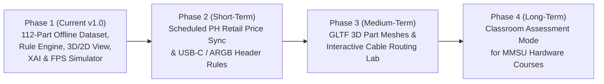

# 07 — Limitations and Future Work

**Project:** Digital PC Builder: Virtual Compatibility & Simulation System  
**Institution:** MMSU College of Computing and Information Sciences (CCIS)

---

## 1. Honest Technical & Scope Limitations

1. **Curated Static Dataset vs. Live Retail Price Scraping:**
   - All 112 components in `/src/data/` use realistic, representative specifications and Philippine Peso (`PHP`) pricing curated for academic demonstration. Because the platform is engineered to run 100% offline with zero paid API keys (`npm install && npm run dev`), prices do not fluctuate in real time with daily retail promotions or stock-outs at Philippine stores (e.g., PCHub, DynaQuest, Bermor Techzone).
2. **Synthetic Performance & Thermal Estimation Models:**
   - The frame rates (1080p, 1440p, 4K), CPU/GPU bottleneck percentages, and full-load temperatures generated by `performanceEngine.ts` are derived from deterministic harmonic-mean mathematical models calibrated against hardware benchmark tiers. Real-world frame rates can vary by $\pm 8\text{--}12\%$ depending on graphics driver versions, game patches, silicon lottery, room ambient temperature in the Philippines, and background OS tasks.
3. **Simplified 3D Bounding-Box Geometry:**
   - The 3D WebGL view (`CaseVisualizer3D.tsx`) and 2D SVG Blueprint (`CaseVisualizer2D.tsx`) use parametric bounding boxes scaled to component millimeter dimensions (`lengthMm`, `heightMm`, `slotWidth`, `formFactor`) rather than heavy, multi-megabyte CAD/GLTF meshes per SKU. This guarantees fast loading and offline bundle portability while still visually communicating spatial proportions and slot conflicts.
4. **Mainstream Desktop Platform Scope:**
   - The rule engine focuses on mainstream consumer and prosumer desktop platforms (`AM4`, `AM5`, `LGA1700` with dual-channel DDR4/DDR5 memory and ATX/SFX power supplies). Server/workstation multi-channel platforms (such as AMD Threadripper `sTR5` 4/8-channel or Intel Xeon) and custom open-loop hardline water-cooling manifolds are excluded.
5. **Secondary Cable & Header Granularity:**
   - While primary power connectors (8-pin PCIe, 16-pin `12VHPWR`, EPS, SATA) and M.2/SATA storage slots are strictly validated, secondary motherboard headers (such as 5V 3-pin ARGB fan headers and front-panel USB 3.2 Gen 2 Type-C `Key-A` internal headers) are not currently modeled as hard failure rules.

---

## 2. Future Development Roadmap

### 2.1 Short-Term Enhancements (3–6 Months)
- **Automated Philippine Retailer Price Updater:** Implement a scheduled GitHub Actions workflow that periodically fetches current PHP pricing and stock flags from local retailer feeds and updates `/src/data/*.ts` via pull requests, keeping the zero-backend runtime intact.
- **Internal Header & PCIe Slot Bifurcation Rules:** Expand `compatibilityEngine.ts` to validate front-panel USB Type-C header matching, PWM/ARGB fan header counts, and PCIe lane sharing when multiple M.2 slots are populated.

### 2.2 Medium-Term Enhancements (6–12 Months)
- **Low-Poly Compressed GLTF 3D Meshes:** Introduce optional Draco-compressed `.glb` models for cases, motherboards, and GPUs while retaining the parametric bounding boxes and 2D SVG blueprint as instant fallbacks.
- **Multi-Monitor & VR Simulation Profiles:** Extend `performanceEngine.ts` to simulate ultrawide (`3440x1440`) and Virtual Reality (`90Hz/120Hz` stereo rendering) frame-time consistency.

### 2.3 Long-Term Academic Integration (12+ Months)
- **MMSU CCIS Classroom "Hardware Troubleshooting Exam Mode":** Allow instructors to generate randomized "broken" PC builds via shareable URLs where students must identify all physical, thermal, and electrical incompatibilities and repair the build within a target budget to earn automated lab grades.
