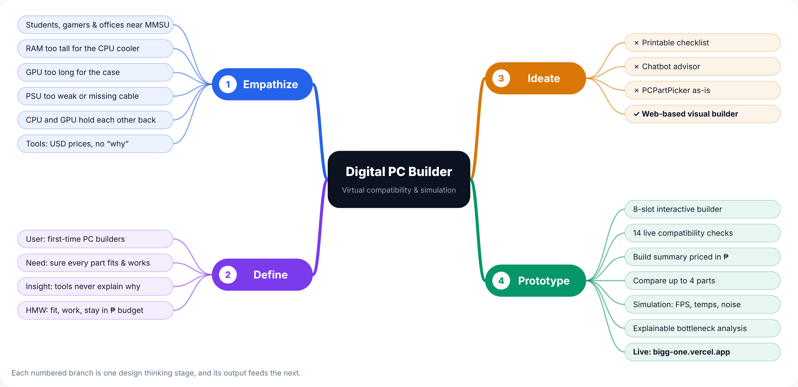

# 10 — Design Thinking Process

**Project:** Digital PC Builder: Virtual Compatibility & Simulation System
**Institution:** MMSU College of Computing and Information Sciences (CCIS)
**Live site:** https://bigg-one.vercel.app

This document shows how each design thinking stage produced the input for the next one: **Empathize → Define → Ideate → Prototype → Test**. It matches slides 2–8 and 18 of the final deck ([`assets/Digital-PC-Builder-Final.pptx`](assets/Digital-PC-Builder-Final.pptx)).

*Each numbered branch is one design thinking stage, and its output feeds the next.*

| Stage | What we did | Output, passed to the next stage |
|---|---|---|
| 1. Empathize | Listened to first-time builders around MMSU and reviewed existing tools | 6 user pain points + 4 gaps in current tools |
| 2. Define | Turned the pain points into one user, need and insight | A "How might we" problem statement |
| 3. Ideate | Compared 4 solution ideas against the user needs | A web-based visual builder with 6 features, each traced to a need |
| 4. Prototype | Built and deployed the React + TypeScript web app | Live site: https://bigg-one.vercel.app |
| 5. Test | Automated rule tests now; usability sessions with real users next | 19 / 19 tests passed + a usability test plan |

---

## 1. Empathize

**Who:** students, gamers and small offices around MMSU who build their own PCs to save money.

**The community concern.** Matching a CPU to a motherboard socket is the easy part. The costly mistakes are the ones buyers can't see until after they've paid:

- RAM too tall for the CPU cooler
- a graphics card too long for the case
- a power supply that's too weak or lacks the right cable
- a CPU and GPU that hold each other back (bottleneck)

The result is returns, wasted pesos and failed first builds.

### Six user pain points (what users told us)

1. They don't understand what a bottleneck is.
2. They don't know which parts a PC needs.
3. They think the more expensive part is always better.
4. They're afraid to buy because listings don't describe the parts.
5. They want to compare parts.
6. They want to know a build will run smoothly before buying.

### Four gaps in existing tools

| Tool | Gap |
|---|---|
| **PCPartPicker** | Checks sockets and GPU length, but not RAM height against the CPU cooler |
| **Bottleneck calculators** | Give a percentage with no explanation of why |
| **Most build tools** | Price in US dollars, not Philippine pesos |
| **Brand builders (e.g. NZXT BLD)** | Only allow their own fixed templates |

**→ Leads to Define:** six pain points and four tool gaps were too many separate problems. We needed to merge them into one statement about who we serve and what they need.

---

## 2. Define

| | |
|---|---|
| **User** | MMSU students and other first-time PC builders |
| **Need** | Confidence that every part fits and works, not just the socket |
| **Insight** | Existing tools catch some mistakes but never explain why, so beginners can't learn from them |

**"How might we" statement**

> *How might we help first-time PC builders choose parts that actually fit, work together and stay within their budget in pesos, before they buy?*

**→ Leads to Ideate:** the statement gave us three tests for every idea. Does it check **fit and compatibility**? Does it work in **pesos**? Does it **explain why**?

---

## 3. Ideate

We judged four ideas against the three tests from the Define stage.

| Idea | Strength | Where it falls short | Decision |
|---|---|---|---|
| Printable checklist / spreadsheet | Cheap | Can't check sizes or power automatically | ✗ Rejected |
| Chatbot advisor | Friendly | Answers aren't consistent or explainable | ✗ Rejected |
| Use PCPartPicker as-is | Already exists | Misses clearance traps, uses USD prices, gives no explanations | ✗ Rejected |
| **Web-based visual builder** | Rule-based compatibility engine, peso prices and plain-language explanations | — | **✓ Chosen** |

It is the only idea that passes all three tests: it checks sizes and power automatically, prices in pesos, and explains each warning.

**Value proposition:** beginner-friendly, priced in pesos, and it explains **why** a part doesn't fit.

**→ Leads to Prototype:** we chose the web-based visual builder and broke it into six features, each answering one of the six user pain points.

---

## 4. Prototype

The prototype is a React + TypeScript web app, deployed at **https://bigg-one.vercel.app**. Every feature traces back to a user need from the Empathize stage:

| User need (Empathize) | Feature (Prototype) | Where to see it |
|---|---|---|
| 1. Don't understand bottlenecks | Explainable CPU vs GPU bottleneck analysis | Simulation tab |
| 2. Don't know which parts are needed | 8-slot interactive builder (CPU, motherboard, cooler, RAM, GPU, storage, PSU, case) | Builder tab |
| 3. Think expensive = better (hard to judge value) | Price-to-performance score (pts per ₱10) | Compare tab |
| 4. Afraid to buy, no descriptions | Part descriptions, spec chips and plain-language red warnings | Builder tab (click a slot) |
| 5. Want to compare parts | Side-by-side comparison of up to 4 parts | Compare tab |
| 6. Want to know it runs smoothly | FPS estimates, temperatures, noise and a 14-check compatibility badge | Simulation tab + header |

The six features from the deck map onto this table:

- **Interactive Builder:** eight hardware slots (needs 2, 4)
- **Compatibility Engine:** 14 live checks and a header badge (needs 4, 6)
- **Build Summarizer:** running total in pesos and a power estimate (Define: stay within budget)
- **Comparison Tool:** up to 4 parts per category on price-to-performance (needs 3, 5)
- **Performance Simulation:** gaming and workstation indexes, temperatures, noise, FPS (need 6)
- **Explainable Insights:** plain-language bottleneck analysis and PSU headroom guidance (need 1, Define insight)

**Example result** (the default Ryzen 5 7600X + RTX 4070 SUPER build): `Compatible (14 Checks)`, ~386W of a 750W PSU, ₱96,690 total, gaming index 89/100, workstation index 71/100.

**→ Leads to Test:** with a working prototype we can check both the rules (automated tests) and the experience (usability testing with real users).

---

## 5. Test, then back to Define

- **Automated rule tests (done):** 19 / 19 Vitest unit tests pass. They cover the same traps users told us about, such as a socket mismatch, 56 mm RAM under a 32 mm cooler limit, a 358 mm GPU in a 315 mm case, a 550 W PSU without a 16-pin cable for an RTX 4090, and a Core i3 + RTX 4090 CPU bottleneck. See [05-testing.md](05-testing.md).
- **Usability testing (next):** MMSU students, gamers, hardware store staff and IT faculty complete four tasks and rate the system on a 12-item SUS-style form (10 standard SUS items + 2 domain items, in [05-testing.md](05-testing.md)).

**Iteration loop:** what we learn in Test goes back into **Define** (is this the problem users feel?) and **Prototype** (fix confusing wording, rules and layouts, refresh prices, and turn the share button into community build sharing).
